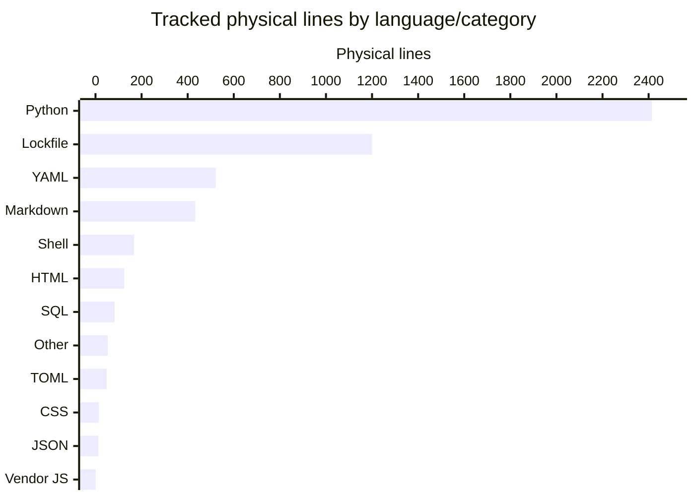

# By the numbers

**Data collected on 2026-11-17.** LedgerLite has 57 tracked files and 5,074 physical lines at `origin/main` (`5cf0fa6`). Its application, schema and tests account for 34 files and 2,638 lines. The complete history contains only 14 commits across two dates; this is a baseline, not evidence of a long-term trend.

See [Architecture](overview/architecture.md), [Testing](how-to-contribute/testing.md) and the dated [Lore](lore.md).

## Scope and reproduction

Measurements use `git ls-tree -r --name-only origin/main` and the corresponding `git show origin/main:<path>` blobs, not untracked working-tree contents. Generated `droid-wiki/` and Git internals are excluded. All tracked dotfiles, automation, instructions, dependencies lockfile and vendored assets are included unless a narrower scope is explicitly stated.

Physical lines are Python `bytes.splitlines()` counts, including comments and blank lines, and including a final unterminated line if present. Bytes are raw blob sizes. Language labels are extension-based rather than syntax-aware: `uv.lock` is separated from TOML; `.env.example`, `.gitignore` and `.python-version` form “Other/dotfiles.” Python structural measurements use system `python3`'s `ast.parse`, without importing or running application code.

History uses `git log origin/main`, author dates in their recorded timezone (all commits here use UTC−05:00), and the full reachable history. Churn uses `git diff-tree --root --no-commit-id --numstat -r <commit>`, including initial additions. These definitions allow reproduction without installing dependencies.

## Lines by language

| Language/category | Files | Physical lines |
|---|---:|---:|
| Python | 25 | 2,414 |
| Lockfile (`uv.lock`) | 1 | 1,200 |
| YAML | 8 | 522 |
| Markdown | 7 | 433 |
| Shell | 2 | 167 |
| HTML | 6 | 125 |
| SQL | 1 | 83 |
| Other/dotfiles | 3 | 53 |
| TOML | 1 | 48 |
| CSS | 1 | 15 |
| JSON | 1 | 13 |
| Vendored JavaScript | 1 | 1 |
| **Total** | **57** | **5,074** |



`app/static/htmx.min.js` is **50,917 bytes on one minified line**: its LOC is not a meaningful measure of implementation size. Total tracked size is 458,437 bytes; `uv.lock` alone contributes 251,184 bytes. Neither generated dependency metadata nor vendored JavaScript should be interpreted as locally authored application complexity.

## Source, tests and configuration

These categories are mutually exclusive and exhaustive. Classification first selects source and tests by path, then Markdown, then everything remaining.

| Classification | Exact rule | Files | Lines |
|---|---|---:|---:|
| Source | Everything under `app/` or `db/`, including templates, vendored assets and package initializers | 20 | 1,164 |
| Tests | Everything under `tests/`, including fixtures/helpers and initializer | 14 | 1,474 |
| Documentation/instructions | Remaining `.md` files, including Factory skills | 7 | 433 |
| Configuration/tooling/lock | All remaining files: workflow YAML, shell helpers, settings, root config/dotfiles and lockfile | 16 | 2,003 |

The source category contains **11 Python files / 940 lines**, six HTML templates / 125 lines, one SQL schema / 83 lines, one CSS file / 15 lines and the one-line vendored JavaScript asset. Tests are **14 Python files / 1,474 lines**, of which **11** are test modules matching `tests/test_*.py`; the other three are `tests/conftest.py`, `tests/helpers.py` and `tests/__init__.py`. Thus the narrower `app/` + `db/` + `tests/` language snapshot is Python 2,414 lines in 25 files, HTML 125 in six, SQL 83 in one, CSS 15 in one and JavaScript one in one.

The test/source-Python physical-line ratio is **1.57:1** (1,474 / 940); this is not test coverage or a test-case count.

## Recent activity and 90-day churn

The inclusive observation window is **2026-08-20–2026-11-17**. There are no commits before the repository's first commit on 2026-11-16.

| Weekly bucket, Monday–Sunday | Commits |
|---|---:|
| 2026-11-02–2026-11-08 | 0 |
| 2026-11-09–2026-11-15 | 0 |
| 2026-11-16–2026-11-22, observed through 2026-11-17 | 14 |

| Monthly bucket within the observation window | Commits |
|---|---:|
| 2026-08-20–2026-08-31 | 0 |
| 2026-09-01–2026-09-30 | 0 |
| 2026-10-01–2026-10-31 | 0 |
| 2026-11-01–2026-11-17 | 14 |

The two active dates are **2026-11-16: six commits** and **2026-11-17: eight commits**. Zero buckets predate repository creation; they do not establish a period of inactivity in an existing project.

Churn below means additions plus deletions, not net growth. “Touches” counts commits changing that path, including creation. These are the ten highest-churn tracked paths in the window:

| Path | Added | Deleted | Churn | Touches |
|---|---:|---:|---:|---:|
| `uv.lock` | 1,200 | 0 | 1,200 | 1 |
| `tests/test_pages_and_csrf.py` | 334 | 12 | 346 | 2 |
| `app/routes/pages.py` | 269 | 9 | 278 | 4 |
| `.factory/skills/qa/scripts/qa-server.sh` | 199 | 72 | 271 | 2 |
| `.github/workflows/qa.yml` | 203 | 11 | 214 | 2 |
| `app/ledger.py` | 209 | 0 | 209 | 2 |
| `README.md` | 150 | 4 | 154 | 6 |
| `tests/test_access_control.py` | 150 | 4 | 154 | 2 |
| `tests/test_recipient_lookup.py` | 153 | 0 | 153 | 1 |
| `app/routes/api.py` | 133 | 6 | 139 | 3 |

Initial import dominates several paths. Churn identifies places to inspect, not defects, ownership or individual productivity.

### Bot attribution, not contributor rankings

A commit is bot-attributed if its **author name/email or any `Co-authored-by:` name/email contains `[bot]`, case-insensitively**. Each commit is counted once, even when a squash message repeats trailers. No inference is made from prose or code style.

- **12 of 14 commits (85.7%)** satisfy that author-or-coauthor rule.
- Three commits have a matching bot author; 12 have at least one matching bot coauthor trailer. Their union is 12, not 15.
- The coauthor-only evidence is a **lower bound of 12 distinct commits** with explicit bot participation. Across those trailers there is **one distinct bot coauthor identity**, deduplicated by lowercase email despite display-name aliases.

Missing trailers cannot establish absence of assistance, and attribution does not measure how much of a commit a bot produced. Individual contributor statistics and rankings are intentionally omitted.

## Structural complexity proxies

### Average file size by directory

Each row includes only files **directly in that directory**, not descendants, so rows do not double-count. Empty/nontracked directories are absent. Means include comments, blanks, metadata and vendor files; they are size proxies, not cyclomatic complexity.

| Directory | Files | Lines | Mean lines/file | Mean bytes/file |
|---|---:|---:|---:|---:|
| Repository root | 8 | 1,511 | 188.88 | 32,899.88 |
| `.factory/` | 1 | 13 | 13.00 | 237.00 |
| `.factory/droids/` | 1 | 21 | 21.00 | 1,430.00 |
| `.factory/skills/qa/` | 3 | 183 | 61.00 | 3,594.33 |
| `.factory/skills/qa-api/` | 1 | 46 | 46.00 | 3,612.00 |
| `.factory/skills/qa-web/` | 1 | 51 | 51.00 | 4,206.00 |
| `.factory/skills/qa/scripts/` | 2 | 167 | 83.50 | 3,585.50 |
| `.github/` | 1 | 14 | 14.00 | 264.00 |
| `.github/workflows/` | 5 | 430 | 86.00 | 3,782.20 |
| `app/` | 8 | 552 | 69.00 | 2,312.00 |
| `app/routes/` | 3 | 388 | 129.33 | 4,083.67 |
| `app/static/` | 2 | 16 | 8.00 | 25,910.00 |
| `app/templates/` | 6 | 125 | 20.83 | 806.50 |
| `db/` | 1 | 83 | 83.00 | 3,690.00 |
| `tests/` | 14 | 1,474 | 105.29 | 4,109.14 |

### Deepest local import chain

AST `Import`/`ImportFrom` nodes in all 11 `app/` Python modules define a directed importer → imported-module graph. Only repository-local `app` modules are retained; `from app.routes import api` resolves to `app.routes.api` as well as the local package. Relative imports are resolved against the containing package. Imports are counted syntactically, not by runtime execution or call relationships.

The longest simple path has **four modules / three import edges**. One tied example is:

```text
app.main → app.routes.api → app.auth → app.config
```

Depth-first traversal refuses to revisit a module already in the current path, recording a cycle instead of recursing forever. **No cycles were found** in this graph. Third-party dependencies, tests, dynamic imports and function-call depth are outside this measure.

### Top-level public Python symbols by package

“Public symbol” here means a directly module-level `FunctionDef`, `AsyncFunctionDef` or `ClassDef` whose name does **not** begin with `_`. Methods, nested definitions, imported/re-exported names, constants, variables such as `app`/`router`, and SQL objects are excluded. This is a naming-based structural count, not a supported public-API guarantee.

| Package, direct modules only | Python files | Functions, including async | Classes | Total |
|---|---:|---:|---:|---:|
| `app` | 8 | 27 | 10 | 37 |
| `app.routes` | 3 | 18 | 6 | 24 |
| **Application total** | **11** | **45** | **16** | **61** |

`app.routes` is not counted again inside the `app` row. Test symbols are excluded from this application interface measure.

## Source pointers

Repository source: `app/`, `app/routes/`, `app/templates/`, `app/static/`, `db/schema.sql`, `tests/`, `pyproject.toml`, `uv.lock`, `.factory/`, `.github/`, `README.md` and `AGENTS.md`. The measured revision is [commit 5cf0fa6](https://github.com/ptfeya/ledgerlite/commit/5cf0fa6e5df944dca6aadd15a13c2bcf72a28500); history claims come from its reachable Git log and per-commit numstat.
