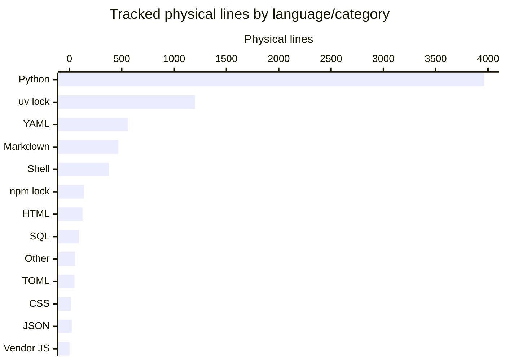

# By the numbers

**Data collected on 2026-11-18.** LedgerLite has 67 tracked files and 7,066 physical lines outside generated `droid-wiki/` at measured [HEAD 13731d4](https://github.com/ptfeya/ledgerlite/commit/13731d47ad1f8ef07f13e0e53f709dc347585211). Its application, schema and tests account for 38 files and 3,572 lines; including local `tools/` gives 41 files and 4,208 lines. The complete history contains only 19 commits across two dates; this is a baseline, not evidence of a long-term trend.

See [Architecture](overview/architecture.md), [Testing](how-to-contribute/testing.md) and the dated [Lore](lore.md).

## Scope and reproduction

Measurements use `git ls-tree -r --name-only 13731d47ad1f8ef07f13e0e53f709dc347585211` and the corresponding `git show 13731d47ad1f8ef07f13e0e53f709dc347585211:<path>` blobs, not staged wiki edits, untracked working-tree contents or a moving branch reference. Generated `droid-wiki/` and Git internals are excluded from size, structure and churn. The full tree has 92 files, including 25 generated wiki files. Since the prior measured [revision 0c1e05f](https://github.com/ptfeya/ledgerlite/commit/0c1e05fff5efbae2974eeb32a0f5db0a1ae1210d), eight non-wiki paths changed with 611 additions and four deletions: a net increase of 607 lines and four files. All tracked dotfiles, automation, instructions, dependency lockfiles and vendored assets are included unless a narrower scope is explicitly stated.

Both the ordinary full diff and the incremental wiki command with exclusions `:!*.lock`, `:!package-lock.json` and `:!*.generated.*` report **611 additions / four deletions**. In this repository the latter command still includes the nested `.factory/skills/qa/tools/package-lock.json`; explicitly excluding `:!**/package-lock.json` instead gives **472 additions / four deletions across seven paths**. These diff scopes do not change the all-tracked size scope below.

Physical lines are Python `bytes.splitlines()` counts, including comments and blank lines, and including a final unterminated line if present. Bytes are raw blob sizes. Language labels are extension-based rather than syntax-aware: `uv.lock` is separated from TOML, and `.factory/skills/qa/tools/package-lock.json` is separated from hand-authored JSON (`.factory/settings.json` and `.factory/skills/qa/tools/package.json`). `.env.example`, `.gitignore` and `.python-version` form “Other/dotfiles.” Python structural measurements use system `python3`'s `ast.parse`, without importing or running application code.

History uses `git log 13731d47ad1f8ef07f13e0e53f709dc347585211`, author dates in their recorded timezone (all commits here use UTC−05:00), and the full reachable history, including the generated-wiki-only commit. Churn uses `git diff-tree --root --no-commit-id --numstat -r <commit>`, including initial additions, then excludes every path under `droid-wiki/`. Thus commit activity includes wiki generation, but file churn consistently excludes it, matching the size scope. These definitions allow reproduction without installing dependencies.

## Lines by language

| Language/category | Files | Physical lines |
|---|---:|---:|
| Python | 31 | 3,960 |
| Lockfile (`uv.lock`) | 1 | 1,200 |
| YAML | 8 | 561 |
| Markdown | 8 | 469 |
| Shell | 3 | 380 |
| npm lockfile (`.factory/skills/qa/tools/package-lock.json`) | 1 | 139 |
| HTML | 6 | 125 |
| SQL | 1 | 90 |
| Other/dotfiles | 3 | 56 |
| TOML | 1 | 48 |
| CSS | 1 | 15 |
| Hand-authored JSON | 2 | 22 |
| Vendored JavaScript | 1 | 1 |
| **Total** | **67** | **7,066** |



`app/static/htmx.min.js` is **50,917 bytes on one minified line**: its LOC is not a meaningful measure of implementation size. Total tracked non-wiki size is 539,953 bytes; `uv.lock` alone contributes 251,184 bytes, and `.factory/skills/qa/tools/package-lock.json` contributes 4,453 bytes. Neither generated dependency metadata nor vendored JavaScript should be interpreted as locally authored application complexity.

## Source, tests and configuration

These categories are mutually exclusive and exhaustive. Classification first selects source and tests by path, then Markdown, then everything remaining.

| Classification | Exact rule | Files | Lines |
|---|---|---:|---:|
| Source | Everything under `app/` or `db/`, plus `.py` files under `tools/`; includes templates, vendored assets and package initializers | 23 | 1,848 |
| Tests | Everything under `tests/`, including fixtures/helpers and initializer | 17 | 2,343 |
| Documentation/instructions | Remaining `.md` files, including Factory skills and `tools/README.md` | 8 | 469 |
| Configuration/tooling/lock | All remaining files: workflow YAML, shell helpers, settings, root config/dotfiles and lockfiles | 19 | 2,406 |

The source category contains **14 Python files / 1,617 lines** (application: 12 / 998; tools: two / 619), six HTML templates / 125 lines, one SQL schema / 90 lines, one CSS file / 15 lines and the one-line vendored JavaScript asset. Tests are **17 Python files / 2,343 lines**, of which **14** are test modules matching `tests/test_*.py`; the other three are `tests/conftest.py`, `tests/helpers.py` and `tests/__init__.py`. Thus the narrower `app/` + `db/` + `tests/` language snapshot is Python 3,341 lines in 29 files, HTML 125 in six, SQL 90 in one, CSS 15 in one and JavaScript one in one.

The test/source-Python physical-line ratio, including tools code, is **1.45:1** (2,343 / 1,617); the narrower test/application-Python ratio is **2.35:1** (2,343 / 998). Neither is test coverage or a test-case count. The [local QA harness](features/qa-harness.md) is included in the broader measure, not hidden among configuration. The 213-line browser wrapper `.factory/skills/qa/scripts/qa-tools.sh` is configuration/tooling under these unchanged rules; its 199-line regression module `tests/test_qa_tools.py` is tests.

## Recent activity and 90-day churn

The inclusive 90-day observation window is **2026-08-21–2026-11-18**. There are no commits before the repository's first commit on 2026-11-16.

| Weekly bucket, Monday–Sunday | Commits |
|---|---:|
| 2026-11-02–2026-11-08 | 0 |
| 2026-11-09–2026-11-15 | 0 |
| 2026-11-16–2026-11-22, observed through 2026-11-18 | 19 |

| Monthly bucket within the observation window | Commits |
|---|---:|
| 2026-08-21–2026-08-31 | 0 |
| 2026-09-01–2026-09-30 | 0 |
| 2026-10-01–2026-10-31 | 0 |
| 2026-11-01–2026-11-18 | 19 |

The two active dates are **2026-11-16: six commits** and **2026-11-17: thirteen commits**; 2026-11-18 has none. One of the latter active date's commits is the generated-wiki-only refresh. Zero buckets predate repository creation; they do not establish a period of inactivity in an existing project.

Churn below means additions plus deletions, not net growth. “Touches” counts commits changing that path, including creation. Excluding generated `droid-wiki/`, the window totals **7,277 additions + 211 deletions = 7,488 changed lines**. The excluded wiki refresh adds 1,540 lines across 25 files and contributes no non-wiki churn. These are the ten highest-churn tracked non-wiki paths in the window:

| Path | Added | Deleted | Churn | Touches |
|---|---:|---:|---:|---:|
| `uv.lock` | 1,200 | 0 | 1,200 | 1 |
| `tools/qa_harness.py` | 619 | 0 | 619 | 1 |
| `tests/test_pages_and_csrf.py` | 350 | 20 | 370 | 3 |
| `tests/test_qa_harness.py` | 337 | 0 | 337 | 1 |
| `app/routes/pages.py` | 296 | 21 | 317 | 5 |
| `.factory/skills/qa/scripts/qa-server.sh` | 199 | 72 | 271 | 2 |
| `tests/test_recipient_lookup.py` | 263 | 5 | 268 | 2 |
| `.github/workflows/qa.yml` | 243 | 12 | 255 | 3 |
| `app/ledger.py` | 218 | 0 | 218 | 3 |
| `.factory/skills/qa/scripts/qa-tools.sh` | 213 | 0 | 213 | 1 |

Directory totals group paths by their first component; root-level files form a separate row. Directory touches count distinct commits, not summed file touches.

| Directory | Added | Deleted | Churn | Touches |
|---|---:|---:|---:|---:|
| `tests/` | 2,394 | 51 | 2,445 | 9 |
| Repository root | 1,532 | 7 | 1,539 | 9 |
| `app/` | 1,176 | 37 | 1,213 | 8 |
| `.factory/` | 946 | 96 | 1,042 | 4 |
| `tools/` | 636 | 0 | 636 | 1 |
| `.github/` | 503 | 20 | 523 | 9 |
| `db/` | 90 | 0 | 90 | 3 |

Initial import dominates several paths. Churn identifies places to inspect, not defects, ownership or individual productivity.

### Bot attribution, not contributor rankings

A commit is bot-attributed if its **author name/email or any `Co-authored-by:` name/email contains `[bot]`, case-insensitively**. Each commit is counted once, even when a squash message repeats trailers. No inference is made from prose or code style.

- **16 of 19 commits (84.21%)** satisfy that author-or-coauthor rule.
- Four commits have a matching bot author; 16 have at least one matching bot coauthor trailer. Their union is 16, not 20.
- The coauthor-only evidence is a **lower bound of 16 distinct commits** with explicit bot participation. Across those trailers there is **one distinct bot coauthor identity**, deduplicated by lowercase email despite display-name aliases.

Missing trailers cannot establish absence of assistance, and attribution does not measure how much of a commit a bot produced. Individual contributor statistics and rankings are intentionally omitted.

## Structural complexity proxies

### Average file size by directory

Each row includes only files **directly in that directory**, not descendants, so rows do not double-count. Empty/nontracked directories are absent. Means include comments, blanks, metadata and vendor files; they are size proxies, not cyclomatic complexity.

| Directory | Files | Lines | Mean lines/file | Mean bytes/file |
|---|---:|---:|---:|---:|
| Repository root | 8 | 1,525 | 190.62 | 33,028.00 |
| `.factory/` | 1 | 14 | 14.00 | 296.00 |
| `.factory/droids/` | 1 | 21 | 21.00 | 1,430.00 |
| `.factory/skills/qa/` | 3 | 188 | 62.67 | 4,077.00 |
| `.factory/skills/qa-api/` | 1 | 46 | 46.00 | 3,612.00 |
| `.factory/skills/qa-web/` | 1 | 54 | 54.00 | 4,687.00 |
| `.factory/skills/qa/scripts/` | 3 | 380 | 126.67 | 5,510.33 |
| `.factory/skills/qa/tools/` | 2 | 147 | 73.50 | 2,335.50 |
| `.github/` | 1 | 14 | 14.00 | 264.00 |
| `.github/workflows/` | 5 | 469 | 93.80 | 4,347.20 |
| `app/` | 9 | 595 | 66.11 | 2,255.11 |
| `app/routes/` | 3 | 403 | 134.33 | 4,323.33 |
| `app/static/` | 2 | 16 | 8.00 | 25,910.00 |
| `app/templates/` | 6 | 125 | 20.83 | 806.50 |
| `db/` | 1 | 90 | 90.00 | 4,046.00 |
| `tests/` | 17 | 2,343 | 137.82 | 5,422.65 |
| `tools/` | 3 | 636 | 212.00 | 8,038.33 |

### Deepest local import chain

AST `Import`/`ImportFrom` nodes in all 31 tracked non-wiki Python modules define a directed importer → imported-module graph. Only repository-local `app`, `tests` and `tools` modules are retained; `from app.routes import api` resolves to `app.routes.api` as well as the local package. Relative imports are resolved against the containing package. Imports anywhere in the AST are counted syntactically, not by runtime execution or call relationships.

The full graph has **76 edges** and a longest simple path of **six modules / five import edges**. One tied example is:

```text
tests.test_ledger_zero_sum → tests.conftest → app.main → app.routes.api → app.auth → app.config
```

The application-only subgraph remains **12 modules / 22 edges**, with a longest path of **four modules / three edges**: `app.main → app.routes.api → app.auth → app.config`. `tools.qa_harness` in `tools/qa_harness.py` imports local application modules and is included in the full graph. The new `tests/test_qa_tools.py` adds no local import edges.

Depth-first traversal refuses to revisit a module already in the current path, recording a cycle instead of recursing forever. **No cycles were found** in either graph. Third-party dependencies, dynamic imports and function-call depth are outside this measure.

### Top-level public Python symbols by package

“Public symbol” here means a directly module-level `FunctionDef`, `AsyncFunctionDef` or `ClassDef` whose name does **not** begin with `_`. Methods, nested definitions, imported/re-exported names, constants, variables such as `app`/`router`, and SQL objects are excluded. This is a naming-based structural count, not a supported public-API guarantee.

| Package, direct modules only | Python files | Functions, including async | Classes | Total |
|---|---:|---:|---:|---:|
| `app` | 9 | 29 | 10 | 39 |
| `app.routes` | 3 | 18 | 6 | 24 |
| **Application total** | **12** | **47** | **16** | **63** |
| `tools` | 2 | 22 | 2 | 24 |
| **Application + tools total** | **14** | **69** | **18** | **87** |

`app.routes` is not counted again inside the `app` row. Test symbols are excluded from this application/tooling interface measure.

## Source pointers

Repository source: `app/`, `app/routes/`, `app/templates/`, `app/static/`, `db/schema.sql`, `tests/`, `tools/`, `pyproject.toml`, `uv.lock`, `.factory/`, `.github/`, `README.md` and `AGENTS.md`. The measured revision is [commit 13731d4](https://github.com/ptfeya/ledgerlite/commit/13731d47ad1f8ef07f13e0e53f709dc347585211); history claims come from its reachable Git log and per-commit numstat, with generated `droid-wiki/` paths excluded from churn.
