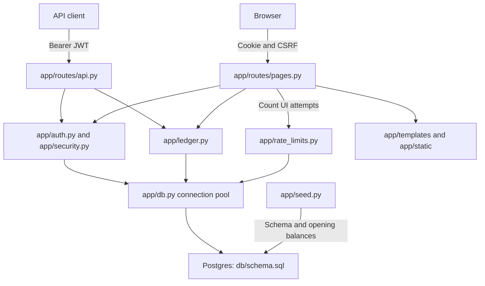

# Architecture

LedgerLite has one HTTP application and one database. API handlers and HTML handlers share authentication helpers and the ledger module, while Postgres provides transaction isolation, row locks, and ledger constraints (`app/main.py`, `app/auth.py`, `app/ledger.py`, `db/schema.sql`).

## Components

`app/main.py` registers both routers and the `/` redirect, mounts `/static`, and disables `/docs`, `/redoc`, and `/openapi.json`. Its lifespan opens a synchronous psycopg pool with a 10-second startup wait, stores it on application state, and closes it on shutdown. `app/db.py` sets pool size to 1–10 connections and returns dictionary rows.

Starting the server does **not** apply the schema. Seeding and tests call `apply_schema` in `app/db.py` explicitly. Changes to `db/schema.sql` therefore need a deliberate application step.

## Money-movement boundary

`execute_transfer` in `app/ledger.py` owns ordinary transfers. Routes validate transport input, then pass integer cents and the authenticated user ID to it. The transaction locks accounts in ID order, checks the endpoints, handles an existing idempotency key, checks the source balance, and inserts equal debit and credit entries.

The deferred trigger in `db/schema.sql` rejects nonzero entry totals for transfers receiving inserts. Another trigger rejects ledger entry updates and deletes. These are narrower guarantees than “the database validates the whole transfer”: exactly two entries, their relationship to the transfer endpoints, ownership, and overdraft protection come from application logic. See [Transfers](../features/transfers.md).

`app/seed.py` is the bootstrap funding exception. It writes balanced opening entries directly and creates an ownerless system account that ordinary transfers cannot use. Local fixtures in `tools/qa_harness.py` also write balanced funding adjustments, only against their isolated harness instance. Neither is a pattern for route implementations.

## Isolated QA harness

`tools/qa_harness.py` derives a marked `_harness` database and `_harness_app` role from the configured local Postgres server. Its administrative connection uses the `postgres` maintenance database; its application runs with the generated restricted-role credentials on a free loopback port. Saved state binds the run to the database and server, and a nonce identifies its process.

Fixture balance adjustments lock account rows in ID order before using `account_balance` in `app/ledger.py`. They add balanced system-account transfers rather than rewriting entries. This helper also backs `balance` in `tests/helpers.py`. Outage simulation disables harness-database connections and terminates its sessions; restart keeps the data, port, and signing secret. See [QA harness](../features/qa-harness.md) for lifecycle commands and limitations.

## UI transfer preflight

After CSRF validation, `transfer_submit` in `app/routes/pages.py` calls `transfer_retry_after` in `app/rate_limits.py`. Its atomic Postgres upsert commits separately from money movement, so failed transfers and successful replays count toward the same per-user 20-attempt, 60-second fixed window across sessions and workers. Throttled requests return `429` with `Retry-After` before recipient lookup or ledger execution. The JSON API does not call this limiter.

Business errors from recipient resolution or execution become the same generic HTML `422` response for both full pages and htmx fragments. This does not hide successful payments or promise timing equivalence. See [Web interface](../features/web-interface.md) and [Security](../security.md).

## Authentication boundary

`get_api_user` in `app/auth.py` reads only the Authorization header; `get_page_user` reads only the session cookie. Both decode an HS256 JWT and fetch the current user record. Admin access uses the current database value rather than an admin claim in the token. `app/security.py` handles Argon2 password hashes, JWTs, cookie flags, and CSRF signatures.

Unauthenticated HTML requests raise `LoginRequired` in `app/auth.py`; the exception handler in `app/main.py` redirects to login. API authentication failures return JSON errors. [Security](../security.md) explains the transport separation and CSRF flows.

## Browser QA boundary

The browser QA stack is separate from the application runtime. `.github/workflows/qa.yml` installs tools from base-branch instructions before the keyed agent runs: agent-browser from a locked npm manifest, a checksum-checked Chrome for Testing archive, and the droid-control marketplace at a fixed commit. `.factory/skills/qa/scripts/qa-tools.sh` first renders a static page to distinguish broken tools from a broken application, then probes the QA login page.

The agent reads `qa-results/preflight.txt`, not a shell exit status. Tool failures produce `QA_PREFLIGHT: BLOCKED`; application failures produce `APP_FAIL` records, even with an `OK` tooling header. API flows are unaffected by browser-tool failures. See [Tooling](../how-to-contribute/tooling.md) and [Testing](../how-to-contribute/testing.md) for the reporting contract (`.factory/skills/qa/SKILL.md`, `tests/test_qa_tools.py`).

## Implementation footprint

At [commit 13731d4](https://github.com/ptfeya/ledgerlite/commit/13731d47ad1f8ef07f13e0e53f709dc347585211), `app/`, `db/`, `tests/`, and `tools/` contain 41 tracked files and 4,208 physical lines: Python 3,960, HTML 125, SQL 90, CSS 15, vendored JavaScript one, and the tools README 17. Counts include blank lines and comments. Excluding `tools/`, the application/schema/test footprint is 38 files and 3,572 lines. The [current language snapshot](../by-the-numbers.md) separates this scope from automation and lockfiles (data collected 2026-11-18).

Python contains the application, tests, and local harness; HTML contains six Jinja templates, SQL the Postgres schema, and CSS the stylesheet (`app/`, `db/schema.sql`, `tests/`, `tools/`). The vendored `app/static/htmx.min.js` is minified onto one line, so its line count is not a useful size comparison.

There is no JavaScript build pipeline or separate frontend runtime in `pyproject.toml`. See [By the numbers](../by-the-numbers.md) for the full measurement scope and [Dependencies](../reference/dependencies.md) for the runtime stack.
