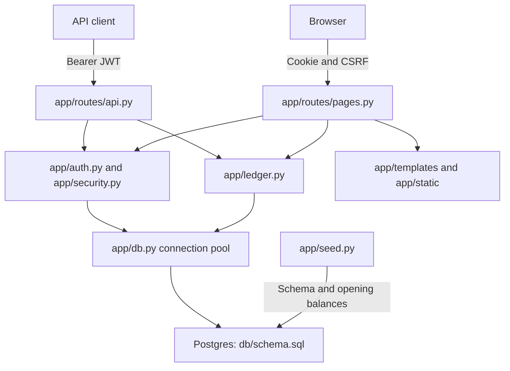

# Architecture

LedgerLite has one HTTP application and one database. API handlers and HTML handlers share authentication helpers and the ledger module, while Postgres provides transaction isolation, row locks, and ledger constraints (`app/main.py`, `app/auth.py`, `app/ledger.py`, `db/schema.sql`).

## Components

`app/main.py` registers both routers and the `/` redirect, mounts `/static`, and disables `/docs`, `/redoc`, and `/openapi.json`. Its lifespan opens a synchronous psycopg pool with a 10-second startup wait, stores it on application state, and closes it on shutdown. `app/db.py` sets pool size to 1–10 connections and returns dictionary rows.

Starting the server does **not** apply the schema. Seeding and tests call `apply_schema` in `app/db.py` explicitly. Changes to `db/schema.sql` therefore need a deliberate application step.

## Money-movement boundary

`execute_transfer` in `app/ledger.py` owns ordinary transfers. Routes validate transport input, then pass integer cents and the authenticated user ID to it. The transaction locks accounts in ID order, checks the endpoints, handles an existing idempotency key, checks the source balance, and inserts equal debit and credit entries.

The deferred trigger in `db/schema.sql` rejects nonzero entry totals for transfers receiving inserts. Another trigger rejects ledger entry updates and deletes. These are narrower guarantees than “the database validates the whole transfer”: exactly two entries, their relationship to the transfer endpoints, ownership, and overdraft protection come from application logic. See [Transfers](../features/transfers.md).

`app/seed.py` is the explicit funding exception. It writes balanced opening entries directly and creates an ownerless system account that ordinary transfers cannot use.

## Authentication boundary

`get_api_user` in `app/auth.py` reads only the Authorization header; `get_page_user` reads only the session cookie. Both decode an HS256 JWT and fetch the current user record. Admin access uses the current database value rather than an admin claim in the token. `app/security.py` handles Argon2 password hashes, JWTs, cookie flags, and CSRF signatures.

Unauthenticated HTML requests raise `LoginRequired` in `app/auth.py`; the exception handler in `app/main.py` redirects to login. API authentication failures return JSON errors. [Security](../security.md) explains the transport separation and CSRF flows.

## Implementation footprint

The tracked application, schema, and tests contain 2,414 physical Python lines, 125 HTML lines, 83 SQL lines, and 15 CSS lines. The vendored JavaScript file is minified onto one line, so its line count is not a useful size comparison. These counts include comments and blank lines, not only executable statements (`app/`, `db/schema.sql`, `tests/`; snapshot 2026-11-17).

There is no JavaScript build pipeline or separate frontend runtime in `pyproject.toml`. See [By the numbers](../by-the-numbers.md) for the full measurement scope and [Dependencies](../reference/dependencies.md) for the runtime stack.
