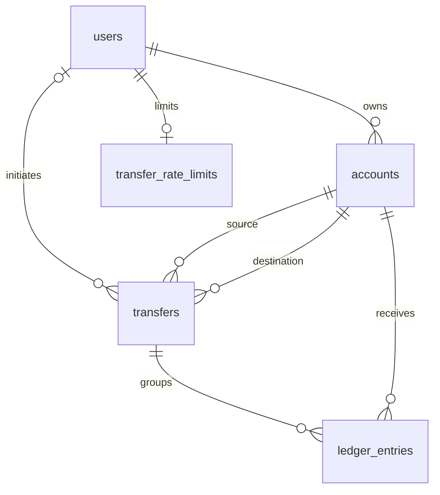

# Data model

LedgerLite stores users, accounts, transfer metadata, signed ledger entries, and UI transfer-attempt counters in five Postgres tables (`db/schema.sql`). Balances are calculated, never stored (`app/ledger.py`).

## Relationships

The diagram omits the ownerless system-account exception: an account has exactly one user unless `is_system=true`, when it must have none. A transfer's `user_id` is nullable. The schema permits transfers with no entries; the application normally creates two.

Source: `db/schema.sql`. See [Transfers](../features/transfers.md) for transaction behavior.

## Tables and columns

The four ledger/identity tables (`users`, `accounts`, `transfers`, `ledger_entries`) have `created_at timestamptz NOT NULL DEFAULT now()`. `transfer_rate_limits` instead records `window_started_at`. Unless marked nullable, columns below are `NOT NULL`; primary keys are inherently non-null (`db/schema.sql`).

### `users`

| Column | Type/default | Constraints |
| --- | --- | --- |
| `id` | `bigint GENERATED ALWAYS AS IDENTITY` | Primary key |
| `email` | `text` | Unique; `email = lower(email)` |
| `password_hash` | `text` | Argon2 hash written by application |
| `is_admin` | `boolean DEFAULT false` | Non-null |

The database lowercase check is not an email-format validator or whitespace normalizer. An idempotent `ALTER TABLE ... ADD COLUMN IF NOT EXISTS` adds `is_admin` to older databases, defaulting existing rows to false.

### `transfer_rate_limits`

| Column | Type/default | Constraints |
| --- | --- | --- |
| `user_id` | `bigint` | Primary key; foreign key to `users.id`, `ON DELETE CASCADE` |
| `window_started_at` | `timestamptz DEFAULT statement_timestamp()` | Start of the current fixed window |
| `attempts` | `integer DEFAULT 1` | Must be positive |

`transfer_retry_after` in `app/rate_limits.py` creates one row on a user's first CSRF-valid UI transfer attempt. Its atomic upsert permits 20 attempts per 60-second window, caps the counter at 21, and resets to one on the next attempt after expiry. The cap is application behavior, not a SQL upper-bound constraint. Blocked attempts leave the start time unchanged. The returned retry delay is rounded up to whole seconds with a minimum of one.

The connection context commits separately from ledger execution, so failed transfers and replays still count. New sessions/workers and schema reapplication preserve the counter; this is a bounded per-user counter, not an attempt audit log. No row is created by ordinary demo seeding. Source and regressions: `app/routes/pages.py`, `app/rate_limits.py`, `app/seed.py`, `tests/test_transfer_rate_limits.py`.

### `accounts`

| Column | Type/default | Constraints |
| --- | --- | --- |
| `id` | `bigint GENERATED ALWAYS AS IDENTITY` | Primary key |
| `user_id` | nullable `bigint` | Foreign key to `users.id` |
| `name` | `text` | No uniqueness constraint |
| `currency` | `char(3) DEFAULT 'USD'` | No allowed-currency list |
| `is_system` | `boolean DEFAULT false` | Controls required ownership |

Check: `(is_system AND user_id IS NULL) OR (NOT is_system AND user_id IS NOT NULL)`. There is no constraint limiting the database to one system account or one Checking account per user.

### `transfers`

| Column | Type/default | Constraints |
| --- | --- | --- |
| `id` | `uuid DEFAULT gen_random_uuid()` | Primary key |
| `user_id` | nullable `bigint` | Foreign key to `users.id` |
| `idempotency_key` | `text` | Non-null; no database length bound |
| `request_hash` | `text` | Non-null; no database digest-format constraint |
| `from_account_id` | `bigint` | Foreign key to `accounts.id` |
| `to_account_id` | `bigint` | Foreign key to `accounts.id`; must differ from source |
| `amount_cents` | `bigint` | Must be positive |

`transfers_user_key_uq` uniquely indexes `(user_id, idempotency_key)`. Default Postgres null semantics mean this does not deduplicate keys across rows with null `user_id`. Seed uses that null initiator for funding. The schema does not constrain null initiators to seed code.

Ordinary requests hash `"<source>|<destination>|<amount>"` with SHA-256 in `app/ledger.py`. The application cap of `10^12` cents and header length limit of 255 are not database constraints.

### `ledger_entries`

| Column | Type/default | Constraints |
| --- | --- | --- |
| `id` | `bigint GENERATED ALWAYS AS IDENTITY` | Primary key |
| `transfer_id` | `uuid` | Foreign key to `transfers.id` |
| `account_id` | `bigint` | Foreign key to `accounts.id` |
| `amount_cents` | `bigint` | Must be nonzero; negative debit, positive credit |

Ledger and account foreign keys use Postgres' default no-action behavior, not cascading deletion. The `transfer_rate_limits.user_id` foreign key is the explicit `ON DELETE CASCADE` exception. No persisted balance column exists: `app/ledger.py` uses `COALESCE(SUM(amount_cents), 0)::bigint` for balances.

`app/ledger.py`'s connection-based `account_balance` returns this aggregate for one account. `tests/helpers.py`'s `balance` and `tools/qa_harness.py` reuse it. The helper itself neither writes entries nor locks accounts; fixture callers acquire their locks before reading.

## Indexes

Primary keys index each ledger/identity table's `id` and `transfer_rate_limits.user_id`; `users.email` also gets its unique-constraint index. Explicit indexes in `db/schema.sql` are:

| Name | Columns | Purpose |
| --- | --- | --- |
| `accounts_user_id_idx` | `accounts(user_id)` | Owner account lookup |
| `transfers_user_key_uq` | `transfers(user_id, idempotency_key)`, unique | User-scoped replay lookup and insertion conflict |
| `ledger_entries_account_idx` | `ledger_entries(account_id, id)` | Balance aggregation and newest-entry reads |
| `ledger_entries_transfer_idx` | `ledger_entries(transfer_id)` | Per-transfer balance check |

## Trigger guarantees, precisely

`ledger_entries_balanced` calls `check_transfer_balanced()` after each inserted row as a `DEFERRABLE INITIALLY DEFERRED` constraint trigger. At deferred execution it sums entries for `NEW.transfer_id` and rejects a nonzero total with SQLSTATE `check_violation`.

`ledger_entries_append_only` calls `forbid_ledger_mutation()` before row updates or deletes and raises `ledger_entries is append-only`.

These do **not** enforce exactly two entries, the correspondence of entry accounts/amounts with transfer metadata, required entries for every transfer, account nonnegative balances, matching currencies, ownership, system-account exclusion, or the application's amount cap. Balanced additional inserts for an existing transfer remain possible. The row-mutation trigger does not intercept `TRUNCATE` or changes to `transfers`. Privileged roles can alter the safeguards.

Normal `app/ledger.py` transfers lock both accounts in ID order, validate ownership/currency/system status, check balance, and insert one debit plus one credit in one transaction. See [Security](../security.md) for the distinction between application and database boundaries.

## Schema and seed lifecycle

`app/db.py` explicitly reads and executes `db/schema.sql`, then commits. The schema uses `CREATE ... IF NOT EXISTS`, replaces trigger functions, and drops/recreates triggers. This is idempotent schema application with a targeted admin-column upgrade and additive rate-limit table, not a general migration framework. Reapplication preserves counters (`tests/test_transfer_rate_limits.py`); server startup in `app/main.py` does not call it.

`uv run python -m app.seed` applies the schema before seeding. `seed()` immediately returns false if **any user exists**. It does not repair partial demo data, reset balances, rotate passwords, or reset admin privileges.

On an empty database it creates:

| Owner | Account | Opening cents |
| --- | --- | --- |
| No user | `System funding` | `-250000`, derived from funding debits |
| `alice@example.com` | `Checking` | `100000` |
| `alice@example.com` | `Savings` | `50000` |
| `bob@example.com` | `Checking` | `75000` |
| `bob@example.com` | `Savings` | `25000` |

This creates two ordinary users, five accounts, four transfers, and eight entries. Four balanced system-to-user funding transfers use null `user_id`, `request_hash='seed'`, and `seed-funding-<account_id>` keys. This direct ledger insertion in `app/seed.py` is an opening-funding exception; routes must use `app/ledger.py`.

Optional `--admin-email <EMAIL>` still runs after the demo seed is skipped. `seed_admin()` trims/lowercases email and creates an admin using the seed password, or promotes an existing user without changing their password or creating accounts. A plain seed rerun neither grants nor revokes admin access.

Regression sources include `tests/test_admin_seed.py`, `tests/test_system_account.py`, `tests/test_ledger_zero_sum.py`, and `tests/test_idempotency.py`. See [Accounts and history](../features/accounts-and-history.md) for derived balances and visibility.

## Isolated fixture adjustments

The local [QA harness](../features/qa-harness.md) adds no schema table. `tools/qa_harness.py` uses the existing five tables in its marked isolated database. `ensure_user` creates missing named accounts and locks the entire requested account batch plus the system account in increasing ID order; `set_balance` locks its account/system pair before reading the balance.

Each nonzero difference creates a transfer with null `user_id`, `request_hash='harness'` and a `harness-fund-<account_id>-<sequence>` key, plus one negative debit and equal positive credit. Raising a fixture balance moves system-to-account; lowering it moves account-to-system. A zero difference creates no transfer or entries. These explicit local fixture writes bypass ordinary endpoint system-account restrictions without changing SQL trigger guarantees or null-key uniqueness semantics. Sources: `tools/qa_harness.py`, `app/ledger.py`, `tests/test_qa_harness.py`.

`fixture reset` truncates `ledger_entries`, `transfers`, `transfer_rate_limits`, `accounts` and `users` with `RESTART IDENTITY CASCADE`, then re-seeds demo users and `qa-admin@example.com`. The CLI confines this destructive reset to its isolated target; it is not ordinary schema reapplication or a development-data repair. See [Testing](../how-to-contribute/testing.md) for the separate pytest and shell-QA databases.
